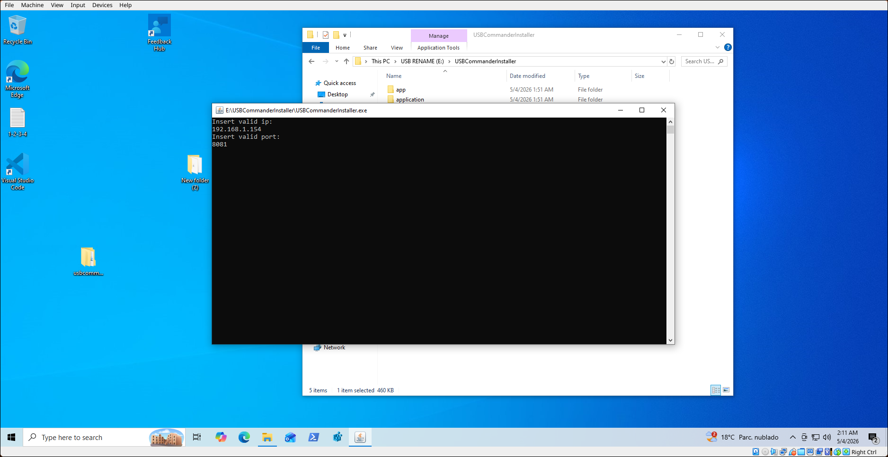
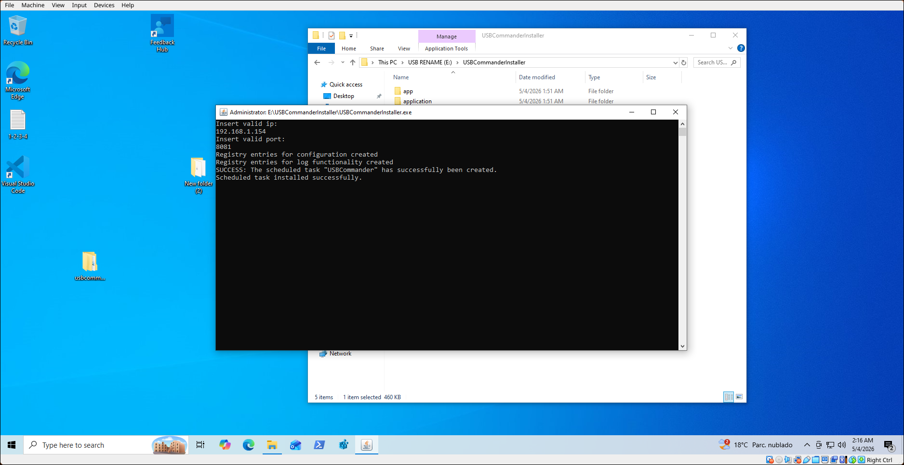
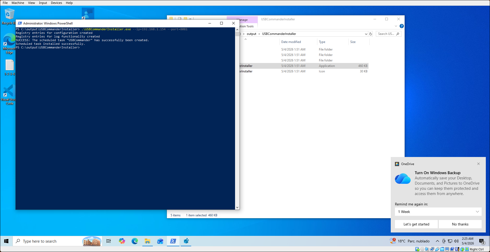
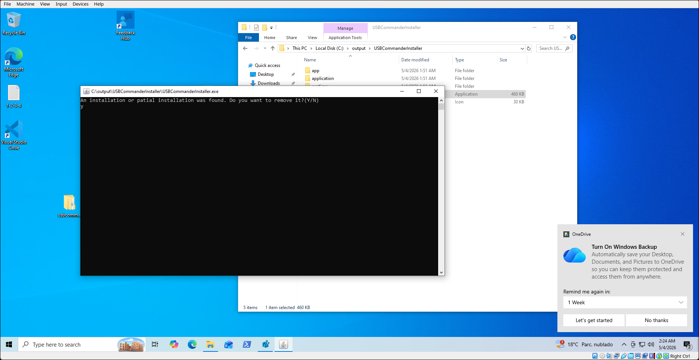
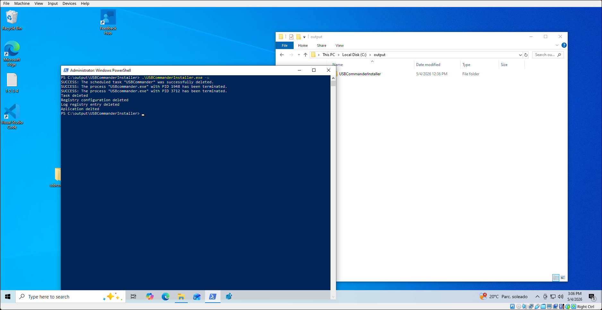

# Requirements
The client application needs to be installed on the computers that are to be monitored. For this task, a dedicated application has been built to prepare the environment required for the client application to run correctly. Thanks to jpackage, the application has been packaged so that it does not require a Java installation to run. However, due to time limitations, it was not possible to configure the application to connect from external networks, so to ensure correct operation, the client must be on the same network as the server. 
Regarding system requirements, the client application requires the computer to meet the following specifications:
- Windows 10/11
- x64 CPU
- 300 MB of RAM dedicated to the application
- Static IP address configured

# Installation
As mentioned above, to run the application correctly, the provided installer must be used. Its use is extremely simple. The only information to keep in mind is the server IP address and socket port. The steps to install it are as follows:
1. Open the UsbCommanderInstaller application with administrator permissions. After that, a window will appear asking for the server IP address:

2. Enter the IP address, after which it will ask for the port, which must also be entered:

3. After that, the application will begin installing, creating the Windows registry entries to store its configuration, creating the channel to emit logs in the Windows Event Viewer, moving the folder with the application files to the Windows installation folder, and preparing a task in Task Scheduler that will allow the application to start with administrator permissions when the operating system starts.

4. At the end, the installer will close. Once the computer is restarted, the application will begin running in the background. However, it is recommended to complete the installation and preparation of the server application before starting the client application.

Alternatively, the installation can be skipped by using the `--ip` and `--port` parameters when executing the installer from the command line:

To uninstall the application, simply open the installer again. It will automatically detect whether any previous USBCommander installation remains (registry entries, application files, etc.) and will offer the option to uninstall the application. It can also be uninstalled by using the `-u` parameter when running the installer from the command line:

When uninstalling the application, all registry entries related to the application will be removed, along with the files. In addition, the system will be configured to re-enable the ability to connect USB drives to the computer.