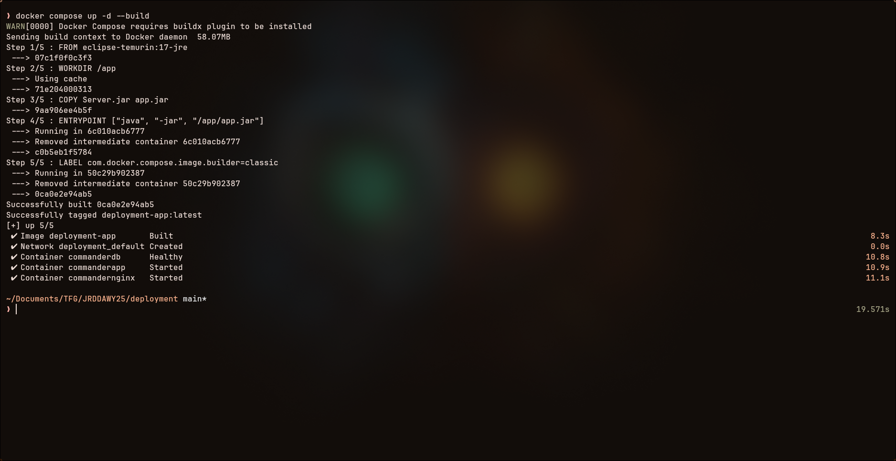
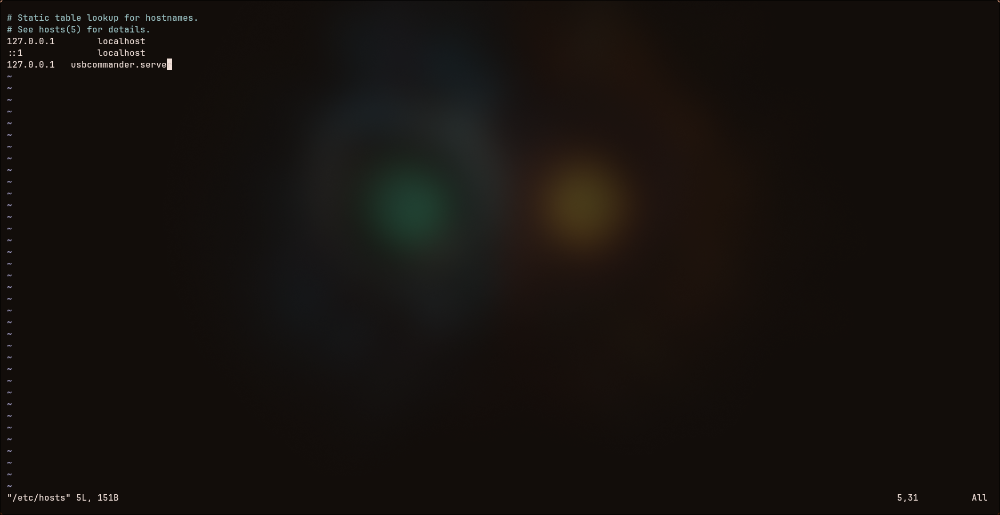

[volver](./README.md)
# Requirements
The server application is responsible for providing an interface for interacting with machines and the information stored in the database, which the server application will also manage.
To run the server application, it is necessary to have an environment capable of executing Java 17 applications, since the application is distributed as a .jar file. In addition, it is necessary to create a MariaDB database in advance with the structure and values described in the creation script, because the application must be able to access the database in order to start correctly.
In addition to the above, the following technical specifications are required, assuming that both the database and the application will run on the same machine:
- 1.5 GB of RAM
- Recommended free space greater than 10 GB
- Minimum 2-core CPU
- Linux is recommended as the operating system

# Installation
The application can be run directly from the .jar file as long as Java 17 has been installed and the MariaDB database has been started. However, it is necessary to configure certain environment variables to allow the application to run correctly:

- COOKIE_SECURE: Must be set to 'true' or 'false' depending on whether the application will be deployed in a production environment or not, because enabling this option requires an SSL certificate on the page to allow the storage and reading of login cookies.

- DATABASE_URL: Address where the MariaDB database is hosted.

- MARIADB_USER: Database user

- MARIADB_PASSWORD: Database user password
- SOCKET_PORT: Port to dedicate to the socket connection used by the client applications
- JWT_SECRET: Key used to generate JWTs that allow access for registered users.
- REFRESH_TOKEN_LIFE: Lifetime in seconds of the token used to generate the users' access tokens.

- ACCESS_TOKEN_LIFE: Lifetime in seconds of the token used to access an account.

- LOG_ROUTE: Path where error logs from client application connections will be generated.

To make the task easier when running the application, a folder with the application, a Docker image, an NGINX configuration file, the database script, an .env file with example variables, and a docker-compose file are provided. This means it is enough to have Docker or Docker Compose installed and run the command `docker compose up -d` or `docker-compose up -d`, depending on the version downloaded, to start an environment with the server application. The Docker Compose file uses additional environment variables:

- DATABASE_ROOT_PASSWORD: MariaDB root user password
- USBCOMMANDER_DATABASE: Name of the database to use
- MARIADB_USER: MariaDB database user. This is used in both the MariaDB container and the UsbCommander server application
- MARIADB_PASSWORD: MariaDB database password. This is used in both the MariaDB container and the UsbCommander server application

- DATABASE_URL: Database address
- SERVER_PORT: Server application port
- SOCKET_PORT: Port to dedicate to the socket connection used by client applications
- JWT_SECRET: Key used to generate JWTs that allow access for registered users.
- REFRESH_TOKEN_LIFE: Lifetime in seconds of the token used to generate the users' access tokens.
- ACCESS_TOKEN_LIFE: Lifetime in seconds of the token used to access an account.
- LOG_ROUTE: Path where error logs from client application connections will be generated.
- COOKIE_SECURE: True enables secure cookies; false disables them
- SERVER_NAME: Name of the NGINX server

This last field is extremely important, because depending on the value defined, it will be necessary to configure and access that address to reach the UsbCommander Server application page. If no configuration is desired, the underscore character `_` can be used, which will allow access from any address pointing to localhost. However, if the address needs to be configured, it will be necessary to edit the file ```/etc/hosts``` on Linux, or ```C:\Windows\System32\drivers\etc\hosts``` on Windows, and add the following line:
```
127.0.0.1   usbcommander.server
```
Replacing "usbcommander.server" with the name used.

